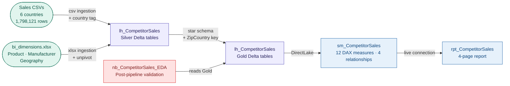

# ws_CompetitorSales — Competitive Sales Intelligence

An end-to-end Microsoft Fabric analytics project built on a public sales
dataset covering Sintec and 14 competing manufacturers across 6 countries
(~1.8M transactions, 2014–2021). Covers raw CSV and Excel ingestion, Silver
validation with documented data quality findings, Gold star-schema
transformation with a ZipCountry composite key, DirectLake semantic
modelling, a four-page Power BI report, and a post-pipeline EDA validation
notebook — all on a single Fabric F2 capacity.

This project was built as part of the Lotusoftware public analytics portfolio,
demonstrating how a governed Fabric medallion pipeline produces a competitive
intelligence report from raw multi-country sales data. The focal question:
*where should Sintec focus product, geography, and pricing strategy to defend
and grow market share?*

---

## The Problem

Sintec competes against 13 manufacturers across 6 countries but has no
structured way to assess whether its revenue performance reflects internal
execution or external market dynamics. The source data exists as six separate
regional CSV files and a multi-sheet Excel dimensions file — with no joined
view, no competitor benchmarking, and no geographic analysis.

**No competitive view.** Revenue data exists per country but is never joined
to manufacturer context — it is impossible to know whether Sintec is gaining
or losing market share without manually combining six files.

**Duplicate Zip codes across countries.** The same postal code appears in
multiple countries (e.g. Zip `27499` exists in both US and international
Geography rows), making a simple Zip-based join between Sales and Geography
incorrect. A composite `ZipCountry` key is required.

**Country naming inconsistency.** The Geography source stores `"USA"` while
the Sales UNION assigns `"United States"` to US rows — a silent join failure
that causes all 753,619 US rows to become orphans in the Geography relationship.

**Known geographic coverage gap.** 1,530 US Zip codes present in Sales have
no matching row in Geography (7.38% of US rows). This is documented as a known
limitation rather than silently dropped — geographic visuals undercount US by
this margin; revenue totals are unaffected.

---

## Architecture

---

## Key Technical Decisions

**ZipCountry composite key resolves duplicate Zip codes across 6 countries** —
a simple `Sales[Zip] → Geography[Zip]` relationship fails because Zip codes
are not globally unique. The composite key `Zip + "_" + Country` is added to
both `gold_fact_sales` and `gold_dim_geography` in the Gold notebook, and the
semantic model relationship is updated to `Sales[ZipCountry] →
Geography[ZipCountry]`.

**Country name standardised in Gold** — the Geography source stores `"USA"`
while the Silver UNION assigns `"United States"` to US rows. The Gold notebook
applies `when(col("Country") == "USA", "United States")` before writing
`gold_dim_geography`, ensuring the composite key joins correctly.

**EDA notebook runs after every pipeline execution** — `nb_CompetitorSales_EDA`
is a post-pipeline validation gate, not a transformation step. It runs NULL
checks, PK uniqueness checks, referential integrity checks, value distribution
checks, and a revenue sanity assert ($600M–$800M) against the live Gold tables.
It is not part of `pl_CompetitorSales`.

**Snowflake schema kept at Gold** — `Sales → Product → Manufacturer` is a
two-hop path. At 1.8M rows with DirectLake, the two-hop cross-filter performance
is acceptable and avoids denormalising ManufacturerID into the fact table.

**Date cast fixed in Gold** — `silver_sales[Date]` is stored as a string in
`MM/dd/yyyy` format. `.cast(DateType())` returns NULL for this format; the fix
uses `to_date(col("Date"), "MM/dd/yyyy")` which casts correctly to a DateType
column in `gold_fact_sales`.

**SQLBI table naming convention** — semantic model display names follow the
Marco Russo / SQLBI convention: fact tables plural (`Sales`), dimension tables
singular (`Product`, `Manufacturer`, `Geography`, `Date`), measures table
`_Measures` (leading underscore sorts to top). The physical Delta table names
(`gold_fact_sales`, `gold_dim_product` etc.) are preserved in the TMDL
`entityName` fields.

**plugin:powerbi-authoring required for all XMLA writes** — the remote HTTP
MCP endpoint (`plugin:fabric-skills`) is read-only by design despite having
`Dataset.ReadWrite.All` permissions in the Entra app registration. All
semantic model writes (table renames, relationship changes, column additions)
must go through `plugin:powerbi-authoring` (local npx, direct XMLA connection).

---

## Data Quality Findings

Four named data quality issues were discovered and documented during the EDA
pass. Each is handled explicitly rather than silently dropped.

| Issue | Table | Impact | Resolution |
|---|---|---|---|
| Duplicate Zip across countries | gold_dim_geography | Join failure on all non-unique Zips | ZipCountry composite key added |
| Country naming mismatch (`USA` vs `United States`) | gold_dim_geography | 753,619 US rows orphaned in Geography | Standardised to `"United States"` in Gold |
| 1,530 US Zip codes missing from Geography | gold_fact_sales | 55,594 orphaned Sales rows (7.38% of US) | Accepted — documented, revenue totals unaffected |
| Date string in `MM/dd/yyyy` format | gold_fact_sales | All Date values NULL after cast | Fixed with `to_date(col("Date"), "MM/dd/yyyy")` |

---

## What Was Built

| Artifact | Type | Description |
|---|---|---|
| `lh_CompetitorSales` | Lakehouse | Single lakehouse — Bronze (CSVs + xlsx), Silver (4 cleaned tables), Gold (5 fact/dim tables) |
| `nb_CompetitorSales_Bronze` | Notebook | Ingests 6 regional sales CSVs + bi_dimensions.xlsx (Product, Manufacturer, Geography sheets) |
| `nb_CompetitorSales_Silver` | Notebook | UNION of 6 country tables, country tag, schema normalisation, Price parse to numeric |
| `nb_CompetitorSales_Gold` | Notebook | Star schema build, ZipCountry composite key, Country standardisation, Date cast fix, significance classification |
| `nb_CompetitorSales_Date` | Notebook | DateDimension 2014–2022, calendar year, MonthYearCode sort column |
| `nb_CompetitorSales_EDA` | Notebook | Post-pipeline Gold validation — NULLs, PK uniqueness, referential integrity, value distributions, revenue assert |
| `pl_CompetitorSales` | Data Pipeline | Orchestrates Bronze → Silver → Gold notebooks in sequence |
| `sm_CompetitorSales` | Semantic model | DirectLake · `_Measures` table · 12 DAX measures · 4 display folders · 4 relationships · SQLBI naming |
| `rpt_CompetitorSales` | Report | 4-page report — Sales Overview, Market Share, Regional Performance, Product Analysis |

---

## Lakehouse Table Inventory

| Table | Layer | Rows | Notes |
|---|---|---|---|
| bronze_sales_usa | Bronze | 753,619 | US regional CSV |
| bronze_sales_japan | Bronze | 527,304 | Japan regional CSV |
| bronze_sales_nigeria | Bronze | 204,904 | Nigeria regional CSV |
| bronze_sales_germany | Bronze | 137,619 | Germany regional CSV |
| bronze_sales_mexico | Bronze | 128,571 | Mexico regional CSV |
| bronze_sales_canada | Bronze | 46,104 | Canada regional CSV |
| bronze_product | Bronze | 2,412 | Product Details sheet |
| bronze_manufacturer | Bronze | 14 | Manufacturer sheet, unpivoted |
| bronze_geography | Bronze | 176,931 | Geography sheet |
| silver_sales | Silver | 1,798,121 | UNION of 6 country tables |
| silver_product | Silver | 2,412 | Price parsed to numeric |
| silver_manufacturer | Silver | 14 | Pass-through |
| silver_geography | Silver | 176,931 | Pass-through |
| gold_fact_sales | Gold | 1,798,121 | ZipCountry key, Date cast to DateType |
| gold_dim_product | Gold | 2,412 | Category NULLs → "Uncategorised" |
| gold_dim_manufacturer | Gold | 14 | |
| gold_dim_geography | Gold | 176,931 | ZipCountry key, USA → United States |
| DateDimension | Gold | 2,557 | 2014-01-01 → 2022-12-31 |

---

## Semantic Model — DAX Measure Library

12 measures across 4 display folders, all using `VAR`/`RETURN` pattern.
Raw columns hidden from report view.

| Display folder | Measure | What it answers |
|---|---|---|
| Volume | `Revenue` | Total pre-calculated revenue in filter context |
| Volume | `Units Sold` | Total units sold in filter context |
| Volume | `Transaction Count` | Count of sales rows in filter context |
| Volume | `Avg Revenue per Transaction` | Revenue ÷ Transaction Count |
| Competitive | `Market Share %` | Sintec revenue ÷ total market revenue |
| Competitive | `Revenue Rank` | Manufacturer rank by revenue (1 = highest) |
| Competitive | `Market Share YoY Change` | Market share vs prior year |
| Time Intelligence | `Revenue YoY Change` | Revenue vs prior year in $ |
| Time Intelligence | `Revenue YoY %` | Revenue vs prior year as % |
| Scope | `Products Sold` | Distinct products with sales |
| Scope | `Manufacturers Active` | Distinct manufacturers with revenue |
| Scope | `Countries with Sales` | Distinct countries with sales |

---

## Relationships

| From | To | Cardinality | Direction | Notes |
|---|---|---|---|---|
| Sales[ProductID] | Product[ProductID] | Many-to-One | Single | |
| Product[ManufacturerID] | Manufacturer[ManufacturerID] | Many-to-One | Single | Snowflake second hop |
| Sales[ZipCountry] | Geography[ZipCountry] | Many-to-One | Single | Composite key |
| Sales[Date] | Date[Date] | Many-to-One | Single | DatePartOnly join |

---

## Report Pages

**Page 1 — Sales Overview**
Four KPI cards (Revenue, Avg Revenue per Transaction, Revenue YoY Change,
Units Sold), line chart (Revenue by MonthYear), combo chart (Units Sold
columns + Revenue YoY% line by MonthYear). Slicers: Country, Year.

**Page 2 — Market Share**
Bar chart (Market Share % by all 14 manufacturers sorted descending),
area chart (Market Share % by MonthYear × top manufacturers), two KPI
cards (Revenue Rank, Market Share %). Slicers: Country, Year.

**Page 3 — Regional Performance**
Bar chart (Revenue by Country), bar chart (Revenue by Region), treemap
(Revenue by Country and State). Slicers: Year, Manufacturer.

**Page 4 — Product Analysis**
Matrix (Category × Manufacturer with Revenue), bar chart (Top 10 Products
by Revenue), donut chart (Revenue by Segment). Slicers: Country, Manufacturer.

---

## EDA Validation Baseline

Run `nb_CompetitorSales_EDA` after every pipeline execution to verify Gold
layer integrity.

| Check | Result |
|---|---|
| NULLs across all Gold tables | ✅ 0 |
| PK duplicates (ZipCountry, ProductID, ManufacturerID) | ✅ 0 |
| Sales→Product orphans | ✅ 0 |
| Sales→Geography orphans | ⚠️ 55,594 (known — 1,530 US Zips missing from Geography) |
| Total revenue assert ($600M–$800M) | ✅ $695,227,516 |
| Date range | 2014-01-04 → 2021-12-31 |

---

## Key Findings

- **Artisans leads overall** at ~$235M (33.8% market share); Sintec is #2 at ~$117M (16.8%)
- **Sintec leads the US in 2021** — a reversal from the aggregate multi-year position
- **US is the largest market** at $243M (34.9% of total revenue)
- **Revenue grows consistently** year-over-year: 88k transactions in 2014 → 318k in 2021
- **"Uncategorised" category** holds disproportionate revenue — source data quality signal worth investigating

**Analyst blind spots acknowledged** (Jon Christiansen — *Thinking Like an Analyst*):
no cost or margin data (revenue ≠ profitability); dataset ends 2021 (historical only,
not predictive); competitor figures share the same source as Sintec (no independent
validation of competitor revenue).

---

## How to Explore This Project

- **Notebooks:** four-stage pipeline — `nb_CompetitorSales_Bronze` →
  `nb_CompetitorSales_Silver` → `nb_CompetitorSales_Gold` →
  `nb_CompetitorSales_Date`
- **Pipeline:** run `pl_CompetitorSales` to execute Bronze → Silver → Gold
  in sequence, then run `nb_CompetitorSales_EDA` to validate Gold output
- **Semantic model:** `_Measures` table contains all 12 DAX measures;
  raw columns are hidden from report view
- **Report:** four pages covering sales trends, competitive market share,
  regional performance, and product analysis
- **`CONTEXT.md`** — session handoff document with decisions, current state,
  and next planned steps (AI-Readiness pass)

---

## Context

Built by [Ali Saghi](https://www.linkedin.com/in/ali-saghi-fabric/) ·
[Lotusoftware](https://lotusoftware.hashnode.dev) · October 2026

Part of the Lotusoftware public analytics portfolio on Microsoft Fabric.
Built using the two-harness agentic workflow described in this
[blog post](https://lotusoftware.hashnode.dev/stop-re-prompting-how-i-built-a-two-harness-agentic-workflow-for-microsoft-fabric).
