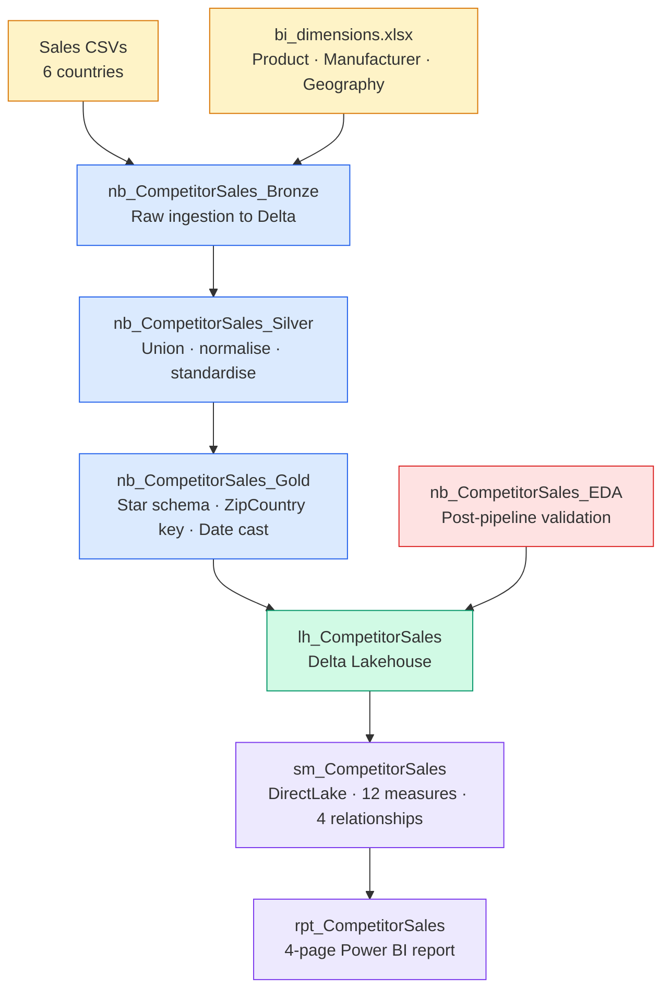

# ws_CompetitorSales — Competitive Sales Intelligence

**Workspace:** `ws_CompetitorSales`  
**Fabric tenant:** `alisaghi2015gmail.onmicrosoft.com`  
**Status:** Active — Wave 5 complete  
**Last updated:** 2026-10-12

---

## Problem Statement

> *What decision does this analysis support?*

Sintec competes against 13 manufacturers across 6 countries but has no structured 
way to assess whether its revenue performance reflects internal execution or external 
market dynamics. This analysis supports one decision:

**Where should Sintec focus product, geography, and pricing strategy to defend and 
grow market share?**

---

## Analyst Mindset Applied

*Framework: "Thinking Like an Analyst" — Jon Christiansen (all 27 episodes)*

| Checkpoint | Answer |
|---|---|
| **Problem** | Where should Sintec focus to defend and grow market share? |
| **Question** | Is Sintec gaining or losing ground, and where and why? |
| **Question type** | Comparison (Sintec vs. 13 competitors) + Relationship (revenue drivers by geography and product) |
| **Measurement** | Revenue as outcome variable; Market Share % = Sintec revenue ÷ total market revenue |
| **Data quality** | 1,530 US Zip codes missing from Geography (7.38% of US rows) — documented, not dropped |
| **Data source** | Internal sales CSVs + bi_dimensions.xlsx; no independent competitor validation |
| **Exploration** | Revenue grows 2014→2021; Artisans leads overall; Sintec leads US in 2021 |
| **Relationships** | Snowflake schema: Sales→Product→Manufacturer; ZipCountry composite key for Geography |
| **Evidence** | Revenue ≠ profitability; no margin data; historical only — not predictive |
| **Comparison** | 6 countries, 14 manufacturers, 2,412 products; segment and category cuts available |
| **Method** | Medallion lakehouse → DirectLake semantic model → comparative Power BI report |
| **Model blind spots** | No cost data; dataset ends 2021; competitor figures share same source as Sintec |
| **AI** | Copilot for report scaffolding; Claude for architecture, DAX, and pipeline code |
| **Insight→Decision** | Sintec should prioritise US (market leader 2021) and investigate Uncategorised product gap |
| **Communication** | 4-page report with Country/Year/Manufacturer slicers for self-service exploration |

---

## Architecture

---

## Fabric Items

| Item | Type | Description |
|---|---|---|
| `lh_CompetitorSales` | Lakehouse | Delta tables — Bronze, Silver, Gold layers |
| `pl_CompetitorSales` | Data Pipeline | Orchestrates Bronze → Silver → Gold notebooks |
| `nb_CompetitorSales_Bronze` | Notebook | Ingests 6 sales CSVs + bi_dimensions.xlsx |
| `nb_CompetitorSales_Silver` | Notebook | UNION · normalise · country standardisation |
| `nb_CompetitorSales_Gold` | Notebook | Star schema · ZipCountry · Date cast · sig classification |
| `nb_CompetitorSales_Date` | Notebook | DateDimension (2014–2022) |
| `nb_CompetitorSales_EDA` | Notebook | Post-pipeline Gold validation gate |
| `sm_CompetitorSales` | Semantic Model | DirectLake · SQLBI naming · 12 measures |
| `rpt_CompetitorSales` | Report | 4-page competitive intelligence report |

---

## Gold Schema

### fact_sales — 1,798,121 rows

| Column | Type | Notes |
|---|---|---|
| ProductID | string | FK → dim_product |
| Date | date | Cast from MM/dd/yyyy string |
| Zip | string | US Zip or international postal code |
| ZipCountry | string | Composite key: Zip + "_" + Country |
| Units | integer | Units sold per transaction |
| Revenue | double | Pre-calculated; not Units × Price |
| Country | string | Standardised: "USA" → "United States" |

### dim_product — 2,412 rows

| Column | Type | Notes |
|---|---|---|
| ProductID | string | PK |
| Product | string | Product name |
| Segment | string | Market segment |
| Category | string | NULLs → "Uncategorised" |
| ManufacturerID | integer | FK → dim_manufacturer |
| Price | double | List price |

### dim_manufacturer — 14 rows

| Column | Type | Notes |
|---|---|---|
| ManufacturerID | integer | PK |
| Manufacturer | string | Manufacturer name |
| Logo | string | Logo path |

### dim_geography — 176,931 rows

| Column | Type | Notes |
|---|---|---|
| Zip | string | Postal code |
| ZipCountry | string | PK composite key |
| City | string | City name |
| State | string | State or prefecture |
| Region | string | Sales region |
| District | string | Sub-region |
| Country | string | Standardised country name |

### DateDimension — 2,557 rows (2014–2022)

Year · Quarter · MonthNumber · MonthName · MonthYear · MonthYearCode · Day · 
DayOfWeek · IsWeekend · YearOffset

---

## Semantic Model

**ID:** `8570540e-a83e-4a5b-b356-e252eeedbb8e`  
**Mode:** DirectLake  
**Naming:** Marco Russo / SQLBI convention (fact tables plural, dimensions singular)

### Relationships

| From | To | Cardinality | Active |
|---|---|---|---|
| Sales[ProductID] | Product[ProductID] | Many-to-One | ✅ |
| Product[ManufacturerID] | Manufacturer[ManufacturerID] | Many-to-One | ✅ |
| Sales[ZipCountry] | Geography[ZipCountry] | Many-to-One | ✅ |
| Sales[Date] | Date[Date] | Many-to-One (DatePartOnly) | ✅ |

### Measures (_Measures table)

| Measure | Format | Folder |
|---|---|---|
| Revenue | $#,0 | Volume |
| Units Sold | #,0 | Volume |
| Transaction Count | #,0 | Volume |
| Avg Revenue per Transaction | $#,0.00 | Volume |
| Market Share % | 0.0% | Competitive |
| Revenue Rank | #,0 | Competitive |
| Market Share YoY Change | 0.0% | Competitive |
| Revenue YoY Change | $#,0 | Time Intelligence |
| Revenue YoY % | 0.0% | Time Intelligence |
| Products Sold | #,0 | Scope |
| Manufacturers Active | #,0 | Scope |
| Countries with Sales | #,0 | Scope |

---

## Report Pages

### Page 1 — Sales Overview
KPI cards: Revenue · Avg Revenue per Transaction · Revenue YoY Change · Units Sold  
Line chart: Revenue by MonthYear  
Combo chart: Units Sold (columns) + Revenue YoY% (line) by MonthYear  
Slicers: Country · Year

### Page 2 — Market Share
Bar chart: Market Share % by Manufacturer (all 14)  
Area chart: Market Share % by MonthYear × Manufacturer (top 5)  
Cards: Revenue Rank · Market Share %  
Slicers: Country · Year

### Page 3 — Regional Performance
Bar chart: Revenue by Country  
Bar chart: Revenue by Region  
Treemap: Revenue by Country and State  
Slicers: Year · Manufacturer

### Page 4 — Product Analysis
Matrix: Category × Manufacturer with Revenue  
Bar chart: Top 10 Products by Revenue  
Donut: Revenue by Segment  
Slicers: Country · Manufacturer

---

## Key Findings

- **Artisans leads overall** at ~$235M (33.8% market share); Sintec is #2 at ~$117M (16.8%)
- **Sintec leads the US in 2021** — a reversal from the aggregate multi-year position
- **US is the largest market** at $243M (34.9% of total revenue)
- **Revenue grows consistently** year-over-year: 88k transactions in 2014 → 318k in 2021
- **"Uncategorised" category** holds disproportionate revenue — source data quality signal

## Known Limitations

- No cost or margin data — revenue ≠ profitability
- Dataset ends 2021 — historical analysis only, not predictive
- Competitor figures share the same source as Sintec — no independent validation
- 1,530 US Zip codes (7.38% of US rows) unmatched in Geography — geographic 
  visuals undercount US by this margin; revenue totals unaffected

---

## Data Quality Baseline (EDA — post Gold pipeline)

| Check | Result |
|---|---|
| NULLs across all Gold tables | ✅ 0 |
| PK duplicates (ZipCountry, ProductID, ManufacturerID) | ✅ 0 |
| Sales→Product orphans | ✅ 0 |
| Sales→Geography orphans | ⚠️ 55,594 (known — 1,530 US Zips missing) |
| Total revenue | ✅ $695,227,516 (within $600M–$800M assert) |
| Date range | 2014-01-04 → 2021-12-31 |

---

## Session History

See `CONTEXT.md` for the full session log.
