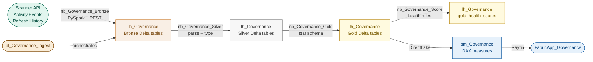

# ws_Governance_Dev — Fabric Governance & Asset Inventory

A tenant-wide governance and asset inventory system built on Microsoft Fabric. Scans
every workspace on a schedule using the Power BI Admin APIs (Scanner, Activity Events,
Refresh History), applies a health rules engine over the collected metadata, and surfaces
findings through a Rayfin app. Phase 5 complete: `FabricApp_Governance` is live —
3 screens (Tenant Health Overview, Workspace Detail, Violations Explorer) built on
`sm_Governance` DirectLake semantic model (5 Gold tables, 7 DAX measures, 28 workspaces scored).

---

## The Problem

A Fabric tenant grows organically — workspaces multiply, owners change, sensitivity
labels go missing, refresh pipelines break silently, and orphaned datasets accumulate.
There is no built-in inventory view that crosses workspace boundaries. This project
builds one: a governed metadata pipeline that collects, normalises, scores, and surfaces
the full tenant asset inventory, updated on a daily schedule.

---

## Architecture

---

## Key Technical Decisions

**SP auth via security group, not workspace membership**
`sp-governance-scanner` is not a workspace member anywhere. It reaches the tenant via
three admin API tenant settings (read-only admin APIs, detailed metadata, DAX/mashup)
scoped to the `sg-fabric-scanner` security group. This is intentional — workspace
membership would require per-workspace provisioning and would break on new workspaces.

**Admin endpoint for refresh history, not workspace endpoint**
`GET /groups/{wsId}/datasets/{id}/refreshes` requires workspace membership or delegated
permission (`Dataset.Read.All` is Delegated-only — no Application variant exists).
The correct endpoint is `GET /admin/datasets/{id}/refreshes`, which is covered by the
read-only admin APIs tenant setting already in place.

**DirectLake models return zero refresh history**
All 33 semantic models in this tenant are DirectLake. DirectLake models read directly
from Delta tables and have no scheduled refresh — the refresh history endpoint returns
an empty array. Cell 6 of `nb_Governance_Bronze` is kept for future use when the scanner
covers client tenants with import-mode models.

**Pipeline provisioning via Fabric UI only**
Git-authored DataPipelines fail during Source Control Update all — Fabric cannot resolve
notebook `logicalId` references in `pipeline-content.json` to live workspace item IDs.
The workaround is: create the pipeline in the Fabric UI, then export the canonical
definition to Git using `Fabric Core MCP → get_item_definition` and a FabricEngineer
git push (bypassing the Fabric→Git commit entirely when the OAuth session is degraded).
The `CLIENT_SECRET` `defaultValue` is always redacted to `""` before committing.

**Scanner depth: `datasetSchema=false`**
The current scan uses `datasourceDetails=true` but `datasetSchema=false` to keep scan
time short across 28 workspaces. `isRefreshable` is not returned at this depth. If
refresh eligibility scoring is needed, re-scan with `datasetSchema=true` (significantly
slower on large tenants).

---

## What Was Built

| Item | Type | Description |
|------|------|-------------|
| `lh_Governance` | Lakehouse | Single lakehouse for all Bronze/Silver/Gold layers. ID `4478b3d6-2e64-43ee-b120-3caa722abf48` |
| `nb_Governance_Bronze` | Notebook | REST ingestion — Activity Events (paginated), Scanner API (trigger/poll/fetch, 100-workspace batches), Refresh History (admin endpoint). Writes three Bronze Delta tables. logicalId `605504c4-9581-4dac-9ee4-fdbee7f74435` |
| `nb_Governance_Silver` | Notebook | Silver transform — parses raw_json from all three Bronze tables into typed Delta tables: `silver_workspaces`, `silver_items`, `silver_activity_events`. logicalId `f645c71e-7e21-4c30-9359-6b69a0407279` |
| `nb_Governance_Gold` | Notebook | Gold schema load — enriches Silver with derived fields (admin_count, last_activity_date, workspace_name joins) and aggregates activity events into `gold_workspaces`, `gold_items`, `gold_activity_summary`. logicalId `1f77ebc4-fd06-40ae-a179-c606d4c45757` |
| `nb_Governance_Score` | Notebook | Health rules engine — evaluates 5 governance rules, writes `gold_health_rule_results` and `gold_health_scores` (score 0–100 per workspace). logicalId `84c8553a-ced6-4f21-afa4-46094baffe61` |
| `pl_Governance_Ingest` | DataPipeline | Orchestrates Bronze → Silver → Gold → Score in sequence (Success dependency chain). `CLIENT_SECRET` injected as pipeline parameter. Daily schedule 06:00 UTC. logicalId `979d10b1-b1d1-8880-4737-a1fe5699952a` |
| `sm_Governance` | SemanticModel | DirectLake semantic model on 5 Gold tables. 7 DAX measures: Total Workspaces, Avg Health Score, Critical Violations, Medium Violations, Workspaces Below 80, Unused Items 90d, Single Admin Workspaces. Item ID `0d12fbd0-4564-4d2d-b9a9-3f3e5fc647a8` |
| `FabricApp_Governance` | Fabric App | Rayfin app surfacing governance health data. 3 screens: Tenant Health Overview, Workspace Detail, Violations Explorer. Live URL: https://hefty-pearl-60b5367c54-northeurope.webapp.fabricapps.net |

---

## DAX Measures

All measures live in the `_Measures` calculated table in `sm_Governance`.

| Measure | Display Folder | Description |
|---------|---------------|-------------|
| `Total Workspaces` | KPIs | Distinct count of workspaces scanned |
| `Avg Health Score` | KPIs | Average governance health score across all workspaces (0–100) |
| `Workspaces Below 80` | KPIs | Count of workspaces with health score < 80 |
| `Critical Violations` | Health Rules | Count of High-severity rule violations |
| `Medium Violations` | Health Rules | Count of Medium-severity rule violations |
| `Unused Items 90d` | Activity | Count of items with no recorded activity in 90 days |
| `Single Admin Workspaces` | Risk | Count of workspaces with `admin_count` ≤ 1 — High-severity governance risk proxy |

---

## Health Rules

| Rule ID | Severity | Description | Data Available |
|---------|----------|-------------|----------------|
| `NO_SENSITIVITY_LABEL` | High | Item has no sensitivity label | No — scanner depth `datasetSchema=false`; enable DAX/mashup expressions |
| `SINGLE_ADMIN` | High | Workspace has only one distinct active user (proxy) | Yes — derived from activity events |
| `REFRESH_FAILING` | High | Semantic model failed refresh 3+ times in 7 days | No — DirectLake tenant returns no refresh history |
| `NO_GIT_CONNECTION` | Medium | Workspace not connected to Git | No — not returned by Scanner API at current depth |
| `UNUSED_REPORT` | Medium | Report not viewed in 90 days | Partial — fires after 90 days of accumulated activity data |

Score formula: `100 - (High violations × 5) - (Medium violations × 3) - (Low violations × 1)`, floored at 0.

---

## How to Explore

**Tables after session 2 run (2026-11-03)**

| Table | Rows | Notes |
|-------|------|-------|
| `bronze_activity_events` | 687 | Yesterday's tenant activity events, raw JSON |
| `bronze_scan_workspaces` | 28 | One row per workspace from Scanner API, raw JSON |
| `bronze_refresh_history` | 0 | All models are DirectLake — expected |
| `silver_workspaces` | 28 | Typed workspace rows |
| `silver_items` | 62 | SemanticModel + Report rows per workspace |
| `silver_activity_events` | 687 | Parsed activity events with canonical field names |
| `gold_workspaces` | 28 | Enriched with admin_count proxy |
| `gold_items` | 62 | Enriched with last_activity_date and workspace_name |
| `gold_activity_summary` | 16 | Aggregated view counts per object (90d / 30d) |
| `gold_health_rule_results` | 149 | One row per rule violation |
| `gold_health_scores` | 28 | One score per workspace (0–100) |

**Run the pipeline**

`pl_Governance_Ingest` orchestrates all four notebooks. Set the `CLIENT_SECRET` parameter
to the real secret value before running. Cell 3 of `nb_Governance_Bronze` always does a
full scan (all workspaces) — `modifiedSince` incremental is deferred due to API format
issues. Activity Events always fetches yesterday's window.

**SP credentials**

The secret `governance-scanner-key-1` is stored only in Fabric notebook Cell 1 — fill
in the Fabric UI before running, never commit. Client ID and tenant ID are safe to commit.

---

## Known Gotchas

- `definition.pbism` for semantic models must contain only `{"version":"1.0"}` — no `artifacts` array; the artifacts array is PBIP/report schema and causes `Workload_FailedToParseFile` on Source Control Update all
- XMLA-provisioned models get a live ObjectId with null LogicalId in Git — causes duplicate artifact conflict on Update all; fix is delete the live artifact (and recycle bin), then reprovision via Git Update all
- After an XMLA session + ExportToTmdlFolder, always do Source Control **Update all** (not Commit) to provision the Git-anchored version — the XMLA artifact and the Git-provisioned artifact are treated as separate items by Fabric
- `scanned_at` must not be included in dedup keys for `silver_workspaces` or `silver_items` — Scanner API pagination returns the same item on multiple pages with identical `scanned_at` timestamps, causing downstream relationship violations in `sm_Governance`

---

*Last updated: 2026-11-04 — Phase 5 complete, FabricApp_Governance live.*
