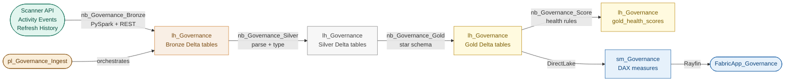

# ws_Governance_Dev — Fabric Governance & Asset Inventory

A tenant-wide governance and asset inventory system built on Microsoft Fabric. Scans
every workspace on a schedule using the Power BI Admin APIs (Scanner, Activity Events,
Refresh History), applies a health rules engine over the collected metadata, and surfaces
findings through a Rayfin app. Phase 1 complete: Bronze layer live with 687 activity
events and 28 workspace scan records from the first run.

---

## The Problem

A Fabric tenant grows organically — workspaces multiply, owners change, sensitivity
labels go missing, refresh pipelines break silently, and orphaned datasets accumulate.
There is no built-in inventory view that crosses workspace boundaries. This project
builds one: a governed metadata pipeline that collects, normalises, scores, and surfaces
the full tenant asset inventory, updated on a daily schedule.

---

## Architecture

---

## Key Technical Decisions

**SP auth via security group, not workspace membership**
`sp-governance-scanner` is not a workspace member anywhere. It reaches the tenant via
three admin API tenant settings (read-only admin APIs, detailed metadata, DAX/mashup)
scoped to the `sg-fabric-scanner` security group. This is intentional — workspace
membership would require per-workspace provisioning and would break on new workspaces.

**Admin endpoint for refresh history, not workspace endpoint**
`GET /groups/{wsId}/datasets/{id}/refreshes` requires workspace membership or delegated
permission (`Dataset.Read.All` is Delegated-only — no Application variant exists).
The correct endpoint is `GET /admin/datasets/{id}/refreshes`, which is covered by the
read-only admin APIs tenant setting already in place.

**DirectLake models return zero refresh history**
All 33 semantic models in this tenant are DirectLake. DirectLake models read directly
from Delta tables and have no scheduled refresh — the refresh history endpoint returns
an empty array. Cell 6 of `nb_Governance_Bronze` is kept for future use when the scanner
covers client tenants with import-mode models.

**Scanner depth: `datasetSchema=false`**
The current scan uses `datasourceDetails=true` but `datasetSchema=false` to keep scan
time short across 28 workspaces. `isRefreshable` is not returned at this depth. If
refresh eligibility scoring is needed, re-scan with `datasetSchema=true` (significantly
slower on large tenants).

---

## What Was Built

| Item | Type | Description |
|------|------|-------------|
| `lh_Governance` | Lakehouse | Single lakehouse for all Bronze/Silver/Gold layers. ID `4478b3d6-2e64-43ee-b120-3caa722abf48` |
| `nb_Governance_Bronze` | Notebook | REST ingestion — Activity Events (paginated), Scanner API (trigger/poll/fetch, 100-workspace batches), Refresh History (admin endpoint). Writes three Bronze Delta tables. logicalId `605504c4-9581-4dac-9ee4-fdbee7f74435` |

---

## How to Explore

**Bronze tables (first run — 2026-11-02)**

| Table | Rows | Notes |
|-------|------|-------|
| `bronze_activity_events` | 687 | Yesterday's tenant activity events, raw JSON |
| `bronze_scan_workspaces` | 28 | One row per workspace from Scanner API, raw JSON |
| `bronze_refresh_history` | 0 | All models are DirectLake — expected |

**Run the Bronze notebook again (incremental)**

Cell 3 checks `MAX(scanned_at)` from `bronze_scan_workspaces` before calling
`/workspaces/modified` — on subsequent runs it fetches only workspaces modified since
the last scan, not the full tenant. Activity Events always fetches yesterday's window.

**SP credentials**

The secret `governance-scanner-key-1` is stored only in Fabric notebook Cell 1 — fill
in the Fabric UI before running, never commit. Client ID and tenant ID are safe to commit.

---

*Last updated: 2026-11-02 — Phase 1 complete, Bronze layer live.*
